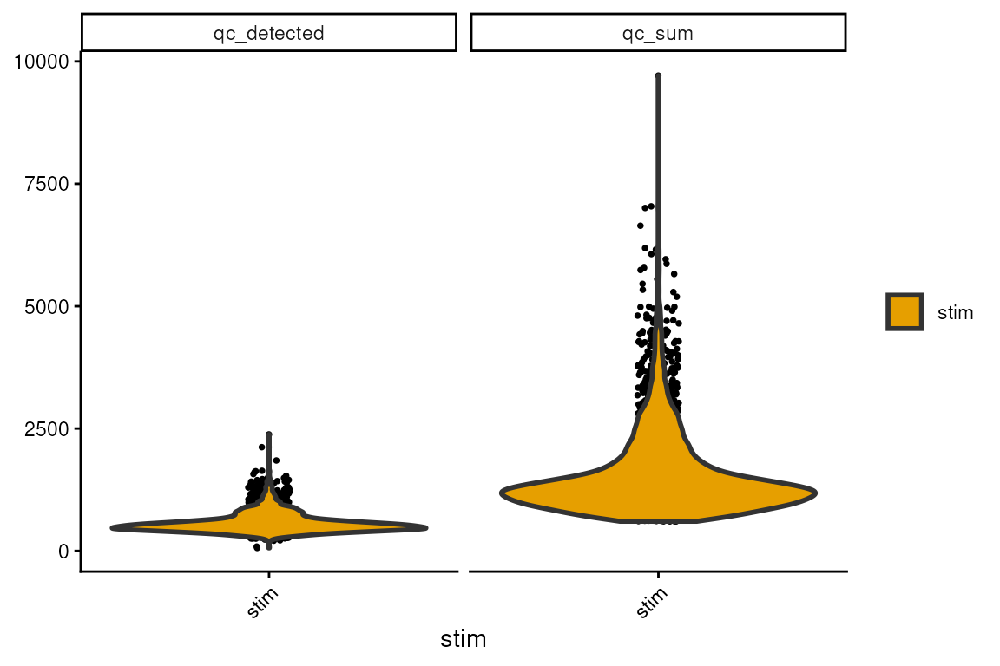
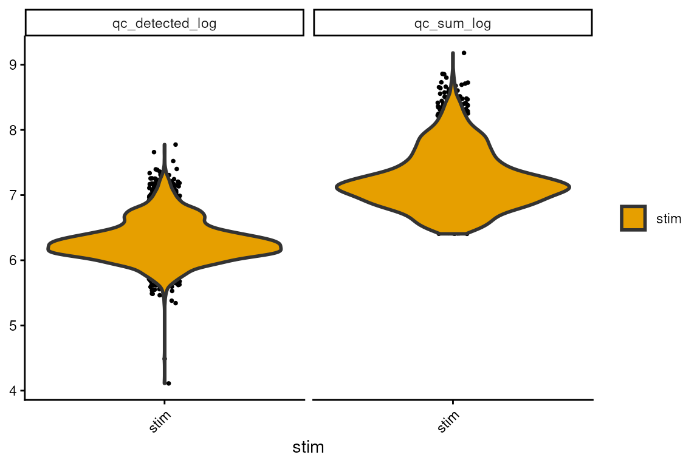
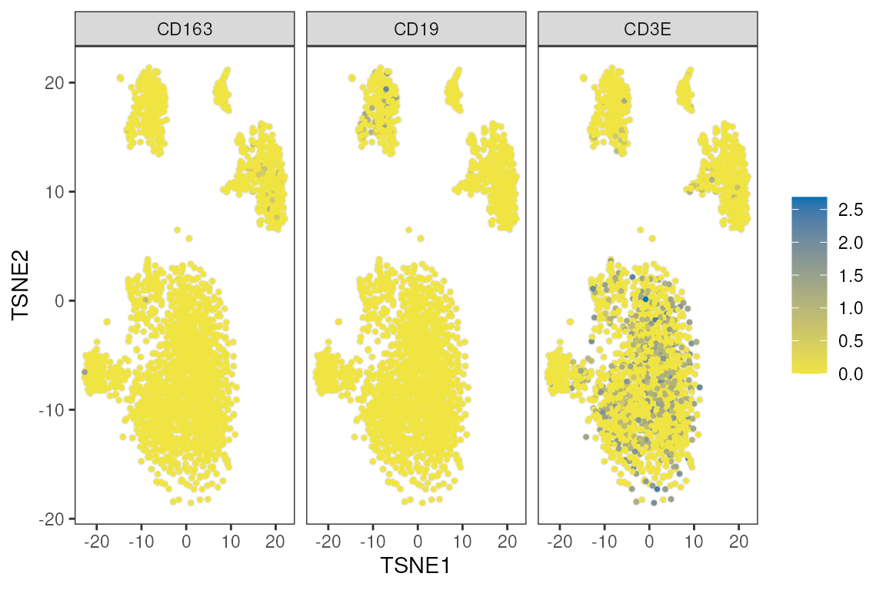
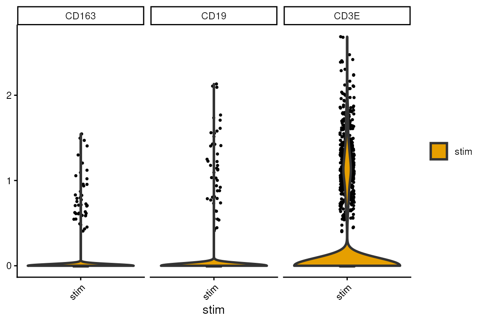
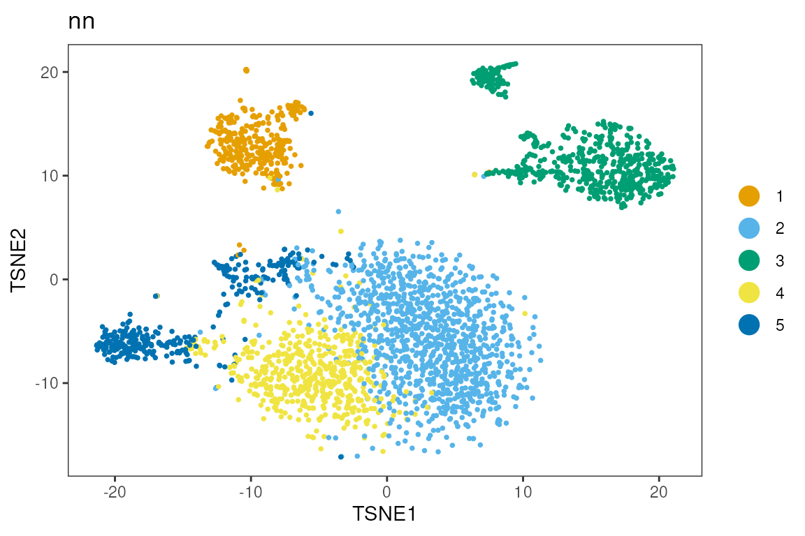
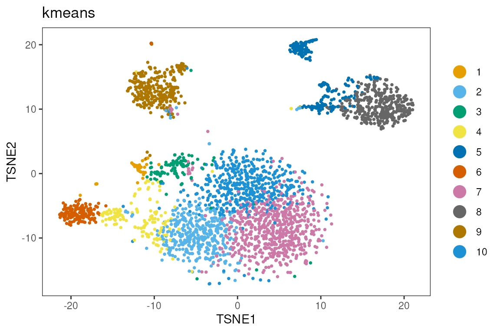
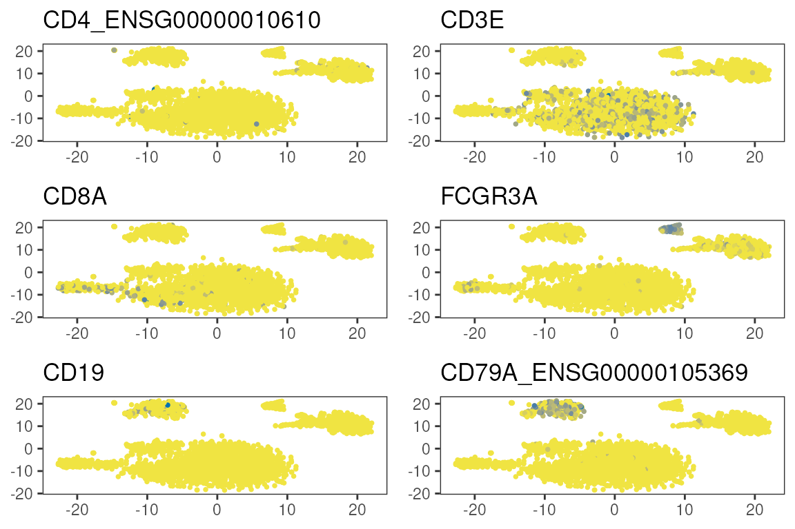

# scRNA-seq analysis workshop

``` r


library(dittoSeq)
library(scuttle)
library(scater)
library(scran)
library(bluster)
```

## Single-cell RNA-seq in Bioconductor

### Data Loading

``` r


library(muscData)
#> Loading required package: ExperimentHub
#> Loading required package: AnnotationHub
#> Loading required package: BiocFileCache
#> Loading required package: dbplyr
#> 
#> Attaching package: 'AnnotationHub'
#> The following object is masked from 'package:Biobase':
#> 
#>     cache
sce<-Kang18_8vs8()
#> see ?muscData and browseVignettes('muscData') for documentation
#> loading from cache
sce<-sce[,sce$ind==1488&sce$stim=='stim']
```

### Quality Control

``` r


is.mito <- grep('^MT-',rownames(sce))
rownames(sce)[is.mito]
#>  [1] "MT-ND1"  "MT-ND2"  "MT-CO1"  "MT-CO2"  "MT-ATP8" "MT-ATP6" "MT-CO3" 
#>  [8] "MT-ND3"  "MT-ND4L" "MT-ND4"  "MT-ND5"  "MT-ND6"  "MT-CYB"
rowSums(counts(sce))[is.mito]
#>  MT-ND1  MT-ND2  MT-CO1  MT-CO2 MT-ATP8 MT-ATP6  MT-CO3  MT-ND3 MT-ND4L  MT-ND4 
#>       0       0       0       0       0       0       0       0       0       0 
#>  MT-ND5  MT-ND6  MT-CYB 
#>       0       0       0

sum(rowSums(counts(sce))==0)
#> [1] 21241

library(scuttle)
df <- perCellQCMetrics(sce, subsets=list(Mito=is.mito))
#> Warning in .per_cell_qc_metrics(assay(x, assay.type), subsets = subsets, : 'perCellQCMetrics' is deprecated.
#> Use 'scrapper::computeRnaQcMetrics' instead.
#> See help("Deprecated")
summary(df$sum)
#>    Min. 1st Qu.  Median    Mean 3rd Qu.    Max. 
#>     604    1015    1290    1552    1786    9709

hist(df$subsets_Mito_sum)
```


``` r


sce$qc_sum<-df$sum
sce$qc_detected<-df$detected
```

``` r


dittoPlot(sce,c('qc_sum','qc_detected'),group.by='stim')
```



``` r

sce$qc_detected_log<-log(sce$qc_detected+1)
sce$qc_sum_log<-log(sce$qc_sum+1)

sce<-logNormCounts(sce)
#> Warning in .library_size_factors(assay(x, assay.type), ...): 'librarySizeFactors' is deprecated.
#> Use 'scrapper::centerSizeFactors' instead.
#> See help("Deprecated")
#> Warning in .local(x, ...): 'normalizeCounts' is deprecated.
#> Use 'scrapper::normalizeCounts' instead.
#> See help("Deprecated")
dittoPlot(sce,c('qc_sum_log','qc_detected_log'),group.by='stim')
```



### Dimension Reduction

``` r


sce<-runPCA(sce, ncomponents=50,ntop=1000)
sce<-runTSNE(sce,dimred='PCA')
```

``` r


sce$ind<-as.character(sce$ind)
```

``` r


dittoDimPlot(sce,reduction.use = 'TSNE',c('CD3E','CD163','CD19'))
```



``` r

dittoPlot(sce,c('CD3E','CD163','CD19'),group.by='stim',slot=2)
```


\## Clustering

``` r


sce$nn<-clusterCells(sce,use.dimred = 'PCA', BLUSPARAM=NNGraphParam(k=20,cluster.fun = 'louvain',cluster.args = list(resolution=0.75)))
#> Warning in clusterCells(sce, use.dimred = "PCA", BLUSPARAM = NNGraphParam(k = 20, : 'clusterCells' is deprecated.
#> Use 'bluster::clusterRows' instead.
#> See help("Deprecated")
sce$kmeans<-clusterCells(sce,use.dimred = 'PCA', BLUSPARAM=KmeansParam(centers=10))
#> Warning in clusterCells(sce, use.dimred = "PCA", BLUSPARAM = KmeansParam(centers = 10)): 'clusterCells' is deprecated.
#> Use 'bluster::clusterRows' instead.
#> See help("Deprecated")

dittoDimPlot(sce,reduction.use = 'TSNE','nn')
```



``` r

dittoDimPlot(sce,reduction.use = 'TSNE','kmeans')
```



``` r


table(sce$cluster,sce$nn)
#>     
#>         1    2    3    4    5
#>   1     0    0   96    0    0
#>   2    15    1    0    2    3
#>   3     3    2    0    2   84
#>   4   312    0    1    1    5
#>   5     0   36    0    6    2
#>   6    20 1046   13  474   48
#>   7     0    0    1    0  166
#>   8     0    0  475    0    0
#>   9     0    0    7    0    0
#>   10    3    1    1   51   37
```

``` r

genes<-c('CD4_ENSG00000010610','CD3E','CD8A','FCGR3A','CD19','CD79A_ENSG00000105369')

genes %in% rownames(sce)
#> [1] TRUE TRUE TRUE TRUE TRUE TRUE

multi_dittoDimPlot(sce,reduction.use='TSNE',genes)
```



``` r

head(rownames(sce))
#> [1] "MIR1302-10"   "FAM138A"      "OR4F5"        "RP11-34P13.7" "RP11-34P13.8"
#> [6] "AL627309.1"
```

### Annotation

``` r


markers<-list(
  T=c('CD3E','CD8A'),
  B=c('CD19','CD79A'),
  NK=c('FCGR3A'),
  Monocyte=c('CD14')
)
```

### Reflection

- How could the analysis have been done differently?
- How does this impact the validity of the results?
- What would have changed if there were cells from multiple samples?

``` r


sessionInfo()
#> R version 4.6.1 (2026-06-24)
#> Platform: x86_64-pc-linux-gnu
#> Running under: Ubuntu 24.04.4 LTS
#> 
#> Matrix products: default
#> BLAS:   /usr/lib/x86_64-linux-gnu/openblas-pthread/libblas.so.3 
#> LAPACK: /usr/lib/x86_64-linux-gnu/openblas-pthread/libopenblasp-r0.3.26.so;  LAPACK version 3.12.0
#> 
#> locale:
#>  [1] LC_CTYPE=en_US.UTF-8       LC_NUMERIC=C              
#>  [3] LC_TIME=en_US.UTF-8        LC_COLLATE=en_US.UTF-8    
#>  [5] LC_MONETARY=en_US.UTF-8    LC_MESSAGES=en_US.UTF-8   
#>  [7] LC_PAPER=en_US.UTF-8       LC_NAME=C                 
#>  [9] LC_ADDRESS=C               LC_TELEPHONE=C            
#> [11] LC_MEASUREMENT=en_US.UTF-8 LC_IDENTIFICATION=C       
#> 
#> time zone: Etc/UTC
#> tzcode source: system (glibc)
#> 
#> attached base packages:
#> [1] stats4    stats     graphics  grDevices utils     datasets  methods  
#> [8] base     
#> 
#> other attached packages:
#>  [1] muscData_1.27.1             ExperimentHub_3.3.2        
#>  [3] AnnotationHub_4.3.2         BiocFileCache_3.3.0        
#>  [5] dbplyr_2.6.0                bluster_1.23.1             
#>  [7] scran_1.41.1                scater_1.41.2              
#>  [9] scuttle_1.23.2              SingleCellExperiment_1.35.2
#> [11] SummarizedExperiment_1.43.0 Biobase_2.73.2             
#> [13] GenomicRanges_1.65.4        Seqinfo_1.3.2              
#> [15] IRanges_2.47.5              S4Vectors_0.51.10          
#> [17] BiocGenerics_0.59.12        generics_0.1.4             
#> [19] MatrixGenerics_1.25.0       matrixStats_1.5.0          
#> [21] dittoSeq_1.25.0             ggplot2_4.0.3              
#> [23] BiocStyle_2.41.0           
#> 
#> loaded via a namespace (and not attached):
#>   [1] DBI_1.3.0            httr2_1.3.0          gridExtra_2.3.1     
#>   [4] rlang_1.3.0          magrittr_2.0.5       otel_0.2.0          
#>   [7] ggridges_0.5.7       compiler_4.6.1       RSQLite_3.53.3      
#>  [10] png_0.1-9            systemfonts_1.3.2    vctrs_0.7.3         
#>  [13] crayon_1.5.3         pkgconfig_2.0.3      fastmap_1.2.0       
#>  [16] XVector_0.53.0       labeling_0.4.3       rmarkdown_2.32      
#>  [19] ggbeeswarm_0.7.3     ragg_1.5.2           purrr_1.2.2         
#>  [22] bit_4.6.0            xfun_0.61            cachem_1.1.0        
#>  [25] beachmat_2.29.3      jsonlite_2.0.0       blob_1.3.0          
#>  [28] DelayedArray_0.39.8  BiocParallel_1.47.0  irlba_2.4.1         
#>  [31] parallel_4.6.1       cluster_2.1.8.3      R6_2.6.1            
#>  [34] bslib_0.12.0         RColorBrewer_1.1-3   limma_3.99.1        
#>  [37] jquerylib_0.1.4      Rcpp_1.1.2           bookdown_0.48       
#>  [40] knitr_1.52           BiocBaseUtils_1.15.1 Matrix_1.7-6        
#>  [43] igraph_2.3.4         tidyselect_1.2.1     abind_1.4-8         
#>  [46] yaml_2.3.12          viridis_0.6.5        codetools_0.2-20    
#>  [49] curl_8.0.0           lattice_0.23-1       tibble_3.3.1        
#>  [52] KEGGREST_1.53.6      withr_3.0.3          S7_0.2.2            
#>  [55] Rtsne_0.17           evaluate_1.0.5       desc_1.4.3          
#>  [58] Biostrings_2.81.9    filelock_1.0.3       pillar_1.11.1       
#>  [61] BiocManager_1.30.27  BiocVersion_3.24.0   scales_1.4.0        
#>  [64] glue_1.8.1           metapod_1.21.0       pheatmap_1.0.13     
#>  [67] tools_4.6.1          BiocNeighbors_2.7.3  ScaledMatrix_1.21.0 
#>  [70] locfit_1.5-9.12      fs_2.1.0             cowplot_1.2.0       
#>  [73] grid_4.6.1           AnnotationDbi_1.75.2 edgeR_4.99.6        
#>  [76] colorspace_2.1-4     beeswarm_0.4.0       BiocSingular_1.29.2 
#>  [79] vipor_0.4.7          cli_3.6.6            rsvd_1.0.5          
#>  [82] rappdirs_0.3.4       textshaping_1.0.5    S4Arrays_1.13.2     
#>  [85] viridisLite_0.4.3    dplyr_1.2.1          gtable_0.3.6        
#>  [88] sass_0.4.10          digest_0.6.39        SparseArray_1.13.4  
#>  [91] ggrepel_0.9.8        dqrng_0.4.1          htmlwidgets_1.6.4   
#>  [94] farver_2.1.2         memoise_2.0.1        htmltools_0.5.9     
#>  [97] pkgdown_2.2.1        lifecycle_1.0.5      httr_1.4.9          
#> [100] statmod_1.5.2        bit64_4.8.6
```
