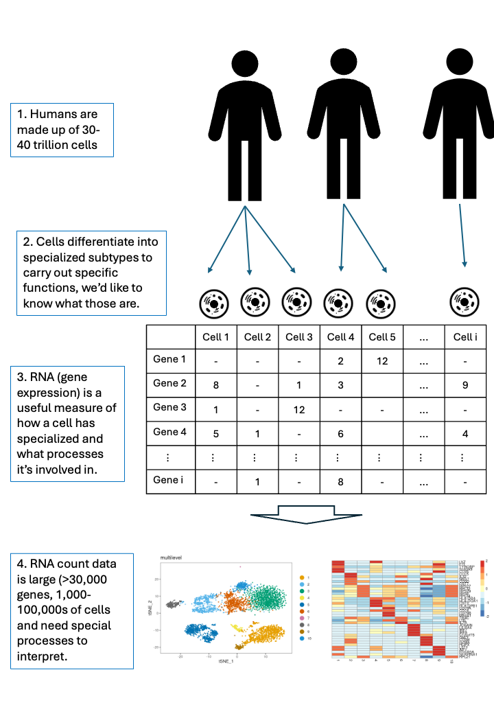

# scRNA-seq background

## Single-cell RNA-seq

- Single-cell data, as the name suggests, is RNA (gene expression)
  measured at the level of single cells.
- The data is tabular, where rows are genes, columns are cells, and
  values represent a count of how many of each RNA was measured in each
  cell when the experiment was carried out.
- This count is not an absolute measurement, and is impacted by both
  experimental and biological factors.
- Cells are dynamic, so think of it as a snapshot of the cell’s state at
  a moment in time.
- Cells differentiate and specialise, meaning they have a hierarchical
  structure.

## Data generation

- Single cells are isolated from a tissue or blood sample, often using a
  microfluidics platform such as the 10x Genomics Chromium system.
- Each cell is captured with a unique barcode, allowing molecules from
  that cell to be tracked throughout the experiment.
- Cellular RNA is converted to cDNA and sequenced, generating millions
  of short sequencing reads made up of base pairs A, T, G, and C.
- The reads are compared to a reference to determine which gene they
  represent.
- Unique molecular identifiers (UMIs) ensure each molecule is counted
  only once.
- Barcodes assign the UMIs back to cells.
- A cell-by-gene count matrix is created, providing the starting point
  for downstream analyses such as quality control, clustering, and
  cell-type annotation.

``` r



```


RNA extracted from single cells can be measured and analysed.

## Exercise

Before diving into the hands-on coding, let’s consider

- how could you preprocess the data?
- what type of questions could you ask from the data?
- how could you verify your interpretation of the data?

``` r


sessionInfo()
#> R version 4.6.1 (2026-06-24)
#> Platform: x86_64-pc-linux-gnu
#> Running under: Ubuntu 24.04.4 LTS
#> 
#> Matrix products: default
#> BLAS:   /usr/lib/x86_64-linux-gnu/openblas-pthread/libblas.so.3 
#> LAPACK: /usr/lib/x86_64-linux-gnu/openblas-pthread/libopenblasp-r0.3.26.so;  LAPACK version 3.12.0
#> 
#> locale:
#>  [1] LC_CTYPE=en_US.UTF-8       LC_NUMERIC=C              
#>  [3] LC_TIME=en_US.UTF-8        LC_COLLATE=en_US.UTF-8    
#>  [5] LC_MONETARY=en_US.UTF-8    LC_MESSAGES=en_US.UTF-8   
#>  [7] LC_PAPER=en_US.UTF-8       LC_NAME=C                 
#>  [9] LC_ADDRESS=C               LC_TELEPHONE=C            
#> [11] LC_MEASUREMENT=en_US.UTF-8 LC_IDENTIFICATION=C       
#> 
#> time zone: Etc/UTC
#> tzcode source: system (glibc)
#> 
#> attached base packages:
#> [1] stats     graphics  grDevices utils     datasets  methods   base     
#> 
#> other attached packages:
#> [1] BiocStyle_2.40.0
#> 
#> loaded via a namespace (and not attached):
#>  [1] digest_0.6.39       desc_1.4.3          R6_2.6.1           
#>  [4] bookdown_0.48       fastmap_1.2.0       xfun_0.61          
#>  [7] cachem_1.1.0        knitr_1.52          htmltools_0.5.9    
#> [10] rmarkdown_2.32      lifecycle_1.0.5     cli_3.6.6          
#> [13] sass_0.4.10         pkgdown_2.2.1       textshaping_1.0.5  
#> [16] jquerylib_0.1.4     systemfonts_1.3.2   compiler_4.6.1     
#> [19] tools_4.6.1         ragg_1.5.2          bslib_0.12.0       
#> [22] evaluate_1.0.5      yaml_2.3.12         BiocManager_1.30.27
#> [25] otel_0.2.0          jsonlite_2.0.0      rlang_1.3.0        
#> [28] fs_2.1.0            htmlwidgets_1.6.4
```
