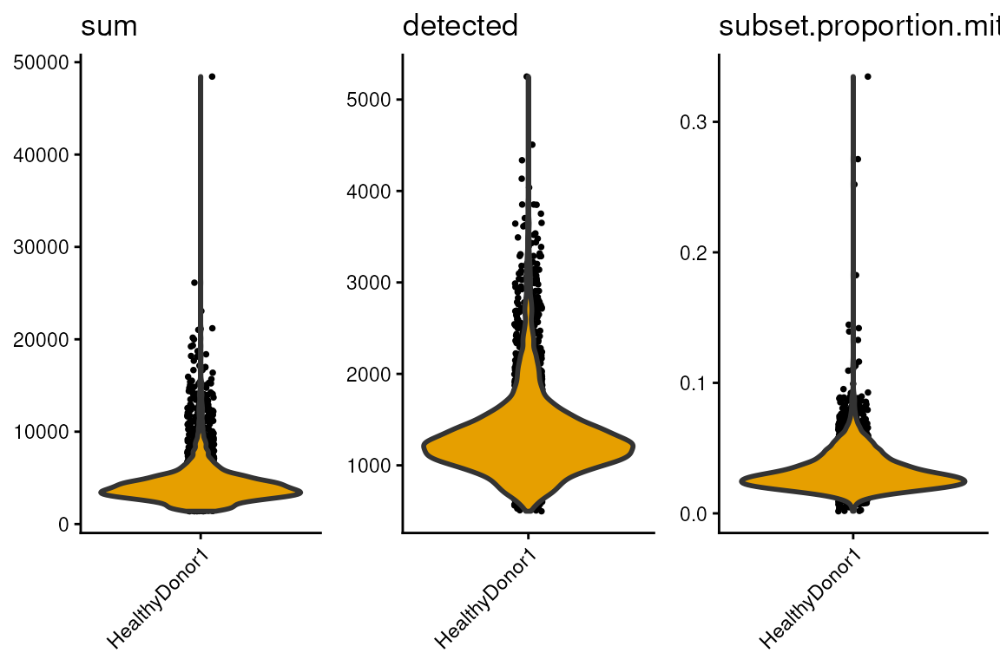
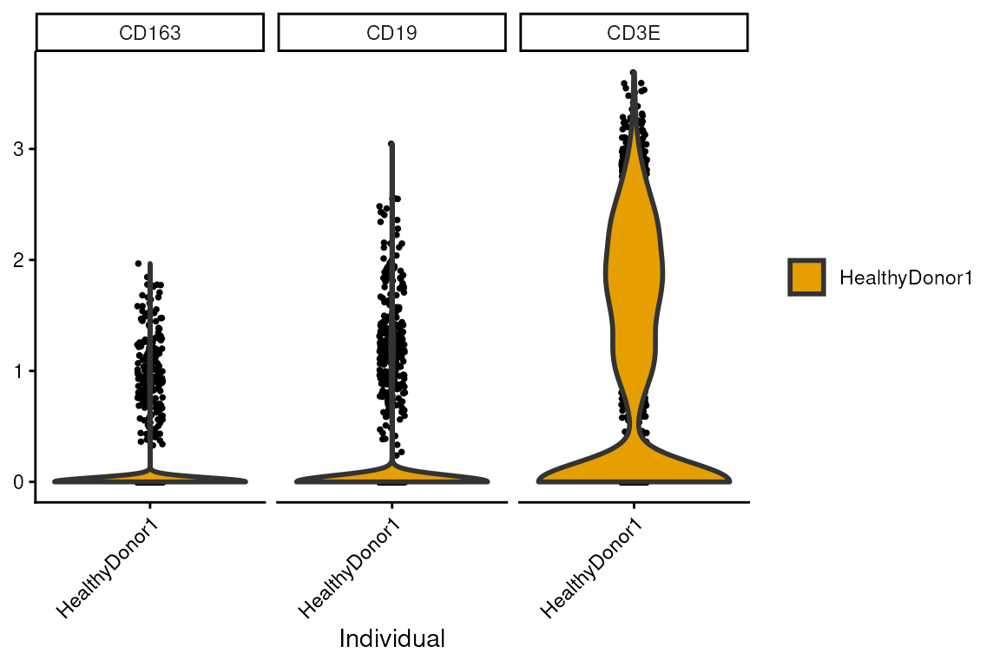
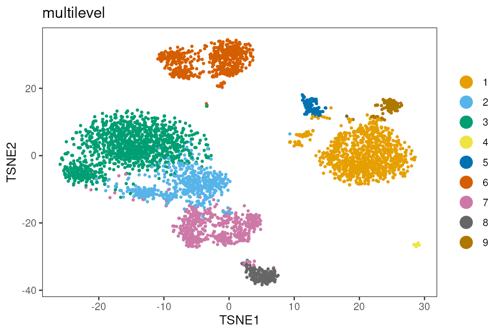
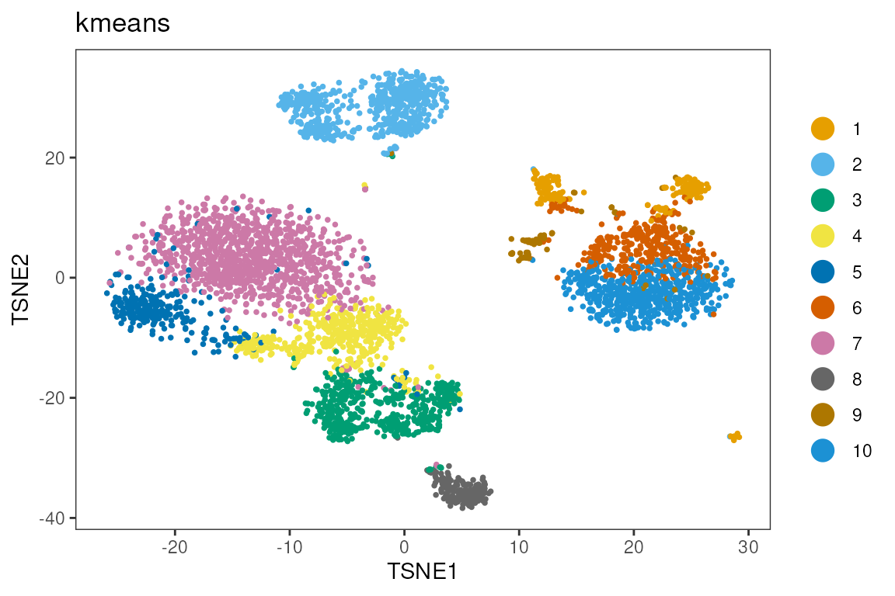
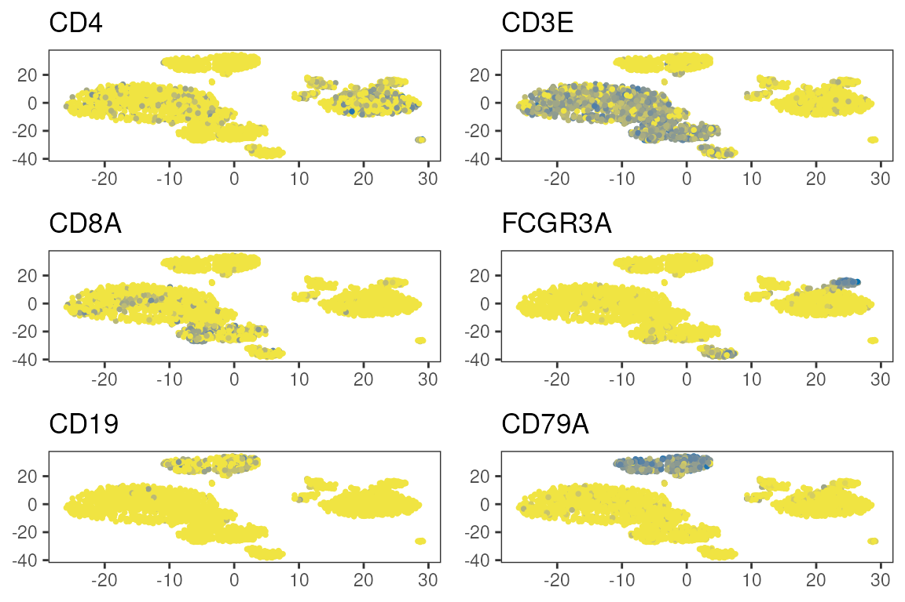
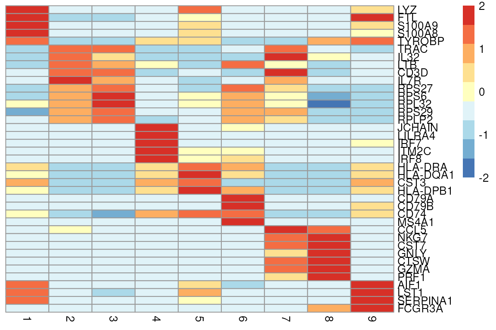
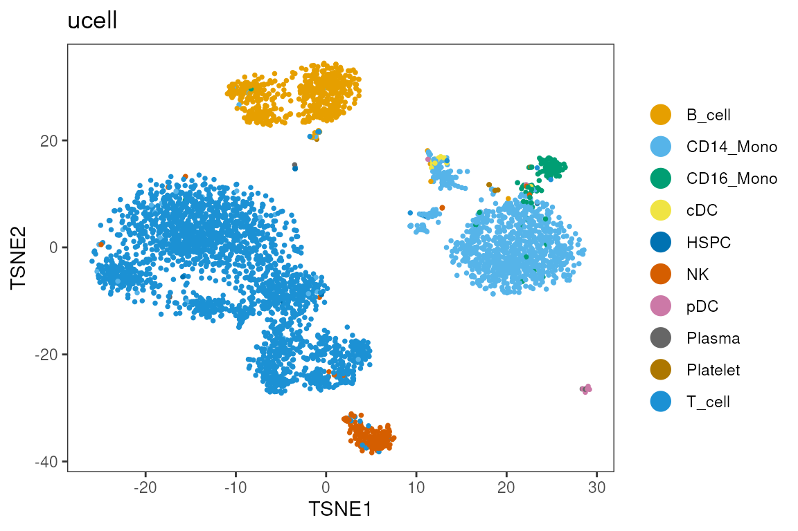

# scRNA-seq single-sample analysis

``` r


library(dittoSeq)
library(scuttle)
library(scater)
library(scran)
library(bluster)
library(TENxPBMCData)
```

## Single-cell RNA-seq in Bioconductor

### Data Loading

``` r


sce <- TENxPBMCData("pbmc4k")
#> see ?TENxPBMCData and browseVignettes('TENxPBMCData') for documentation
#> loading from cache
```

``` r


head(rowData(sce))
#> DataFrame with 6 rows and 3 columns
#>                      ENSEMBL_ID   Symbol_TENx       Symbol
#>                     <character>   <character>  <character>
#> ENSG00000243485 ENSG00000243485  RP11-34P13.3           NA
#> ENSG00000237613 ENSG00000237613       FAM138A      FAM138A
#> ENSG00000186092 ENSG00000186092         OR4F5        OR4F5
#> ENSG00000238009 ENSG00000238009  RP11-34P13.7 LOC100996442
#> ENSG00000239945 ENSG00000239945  RP11-34P13.8           NA
#> ENSG00000239906 ENSG00000239906 RP11-34P13.14           NA


head(colData(sce))
#> DataFrame with 6 rows and 11 columns
#>        Sample            Barcode         Sequence   Library Cell_ranger_version
#>   <character>        <character>      <character> <integer>         <character>
#> 1      pbmc4k AAACCTGAGAAGGCCT-1 AAACCTGAGAAGGCCT         1                v2.1
#> 2      pbmc4k AAACCTGAGACAGACC-1 AAACCTGAGACAGACC         1                v2.1
#> 3      pbmc4k AAACCTGAGATAGTCA-1 AAACCTGAGATAGTCA         1                v2.1
#> 4      pbmc4k AAACCTGAGCGCCTCA-1 AAACCTGAGCGCCTCA         1                v2.1
#> 5      pbmc4k AAACCTGAGGCATGGT-1 AAACCTGAGGCATGGT         1                v2.1
#> 6      pbmc4k AAACCTGCAAGGTTCT-1 AAACCTGCAAGGTTCT         1                v2.1
#>   Tissue_status Barcode_type   Chemistry Sequence_platform    Individual
#>     <character>  <character> <character>       <character>   <character>
#> 1            NA     Chromium Chromium_v2         Hiseq4000 HealthyDonor1
#> 2            NA     Chromium Chromium_v2         Hiseq4000 HealthyDonor1
#> 3            NA     Chromium Chromium_v2         Hiseq4000 HealthyDonor1
#> 4            NA     Chromium Chromium_v2         Hiseq4000 HealthyDonor1
#> 5            NA     Chromium Chromium_v2         Hiseq4000 HealthyDonor1
#> 6            NA     Chromium Chromium_v2         Hiseq4000 HealthyDonor1
#>   Date_published
#>      <character>
#> 1     2017-11-08
#> 2     2017-11-08
#> 3     2017-11-08
#> 4     2017-11-08
#> 5     2017-11-08
#> 6     2017-11-08

table(sce$Individual)
#> 
#> HealthyDonor1 
#>          4340
```

``` r


rownames(sce)<-rowData(sce)$Symbol_TENx
colnames(sce)<-sce$Barcode
```

### Quality Control

``` r


is.mito <- grep('^MT-',rownames(sce),value = T)
is.mito
#>  [1] "MT-ND1"  "MT-ND2"  "MT-CO1"  "MT-CO2"  "MT-ATP8" "MT-ATP6" "MT-CO3" 
#>  [8] "MT-ND3"  "MT-ND4L" "MT-ND4"  "MT-ND5"  "MT-ND6"  "MT-CYB"


library(scrapper)
#> 
#> Attaching package: 'scrapper'
#> The following object is masked from 'package:scran':
#> 
#>     scoreMarkers
#> The following objects are masked from 'package:scater':
#> 
#>     aggregateAcrossCells, normalizeCounts
#> The following objects are masked from 'package:scuttle':
#> 
#>     aggregateAcrossCells, normalizeCounts
df <- perCellQCMetrics(sce, subsets=list(Mito=is.mito))
#> Warning in .per_cell_qc_metrics(assay(x, assay.type), subsets = subsets, : 'perCellQCMetrics' is deprecated.
#> Use 'scrapper::computeRnaQcMetrics' instead.
#> See help("Deprecated")
#> using unknown matrix fallback for 'HDF5ArraySeed'
summary(df$sum)
#>    Min. 1st Qu.  Median    Mean 3rd Qu.    Max. 
#>    1386    3071    3866    4349    4906   48443

sce<-quickRnaQc.se(sce,subsets = list(mito=c(is.mito)))
#> using unknown matrix fallback for 'HDF5ArraySeed'
```

``` r


multi_dittoPlot(sce,c('sum','detected','subset.proportion.mito'),group.by='Individual')
```



### Dimension Reduction

``` r


sce<-normalizeRnaCounts.se(sce)
#> using unknown matrix fallback for 'HDF5ArraySeed'

set.seed(1)
sce <- chooseRnaHvgs.se(sce, top = 1000)
#> using unknown matrix fallback for 'HDF5ArraySeed'

set.seed(1)
sce<-runPca.se(sce, features=rowData(sce)$hvg,number=100)
#> using unknown matrix fallback for 'HDF5ArraySeed'

set.seed(1)
sce<-runTsne.se(sce,reddim.type ='PCA')
```

``` r


dittoDimPlot(sce,reduction.use = 'TSNE',c('CD3E','CD163','CD19'))
```


``` r

dittoPlot(sce,c('CD3E','CD163','CD19'),group.by='Individual',slot='logcounts')
```



### Clustering

``` r


sce<-clusterGraph.se(sce,reddim.type = 'PCA', num.neighbors = 20,output.name = 'multilevel')
sce<-clusterKmeans.se(sce,reddim.type = 'PCA',k=10,output.name = 'kmeans')

dittoDimPlot(sce,reduction.use = 'TSNE','multilevel')
```



``` r

dittoDimPlot(sce,reduction.use = 'TSNE','kmeans')
```



``` r


table(sce$multilevel,sce$kmeans)
#>    
#>       1   2   3   4   5   6   7   8   9  10
#>   1   7   0   0   0   0 332   0   0  72 538
#>   2   0   0   2 436  39   0  85   0   1   0
#>   3   0   0   0   1 230   0 968   0   0   0
#>   4  34   3   0   0   0   0   0   0   0   0
#>   5 103   1   0   0   0  17   0   0   2   0
#>   6   0 608   1   1   0   0   1   0   1   0
#>   7   0   1 514  25  16   0   7   5   0   0
#>   8   0   0   2   0   0   0   0 174   1   0
#>   9 104   0   0   0   0   6   0   0   2   0
```

``` r

genes<-c('CD4','CD3E','CD8A','FCGR3A','CD19','CD79A')

genes %in% rownames(sce)
#> [1] TRUE TRUE TRUE TRUE TRUE TRUE

multi_dittoDimPlot(sce,reduction.use='TSNE',genes)
```



``` r

head(rownames(sce))
#> [1] "RP11-34P13.3"  "FAM138A"       "OR4F5"         "RP11-34P13.7" 
#> [5] "RP11-34P13.8"  "RP11-34P13.14"
```

``` r


markers<-scoreMarkers.se(sce,groups = sce$multilevel,order.by = TRUE)
#> using unknown matrix fallback for 'HDF5ArraySeed'

top_genes <- unique(unlist(lapply(markers, function(df) {
  head(rownames(df)[order(df$cohens.d.mean, decreasing = TRUE)], 5)
}), use.names = FALSE))

top_genes
#>  [1] "LYZ"      "FTL"      "S100A9"   "S100A8"   "TYROBP"   "TRAC"    
#>  [7] "IL32"     "LTB"      "CD3D"     "IL7R"     "RPS27"    "RPS6"    
#> [13] "RPL32"    "RPS29"    "RPLP2"    "JCHAIN"   "LILRA4"   "IRF7"    
#> [19] "ITM2C"    "IRF8"     "HLA-DRA"  "HLA-DQA1" "CST3"     "HLA-DPB1"
#> [25] "CD79A"    "CD79B"    "CD74"     "MS4A1"    "CCL5"     "NKG7"    
#> [31] "CST7"     "GNLY"     "CTSW"     "GZMA"     "PRF1"     "AIF1"    
#> [37] "LST1"     "SERPINA1" "FCGR3A"

plotGroupedHeatmap(sce,
                   features     = top_genes,
                   group        = 'multilevel',
                   center       = TRUE,
                   scale        = TRUE,
                   zlim         = c(-2, 2),
                   cluster_rows = FALSE,
                   cluster_cols = FALSE)
```



### Supervised Annotation

``` r


library(UCell)
counts(sce) <- as(counts(sce), "dgCMatrix")   # in-memory sparse; TENxPBMCData is HDF5-backed

signatures <- list(
  T_cell      = c("CD3D", "CD3E", "CD3G", "CD2", "TRAC"),
  NK          = c("NKG7", "GNLY", "KLRD1", "KLRF1", "CD3D-", "CD3E-"),
  B_cell      = c("MS4A1", "CD79A", "CD79B", "CD19", "BANK1"),
  Plasma      = c("MZB1", "DERL3", "TNFRSF17", "XBP1", "MS4A1-"),
  CD14_Mono   = c("CD14", "LYZ", "S100A8", "S100A9", "VCAN", "FCGR3A-"),
  CD16_Mono   = c("FCGR3A", "MS4A7", "CDKN1C", "LST1", "CD14-", "NKG7-"),
  cDC         = c("FCER1A", "CD1C", "CLEC10A", "CLEC9A", "CD14-"),
  pDC         = c("LILRA4", "CLEC4C", "IL3RA", "PLD4"),
  Platelet    = c("PPBP", "PF4", "GP9", "ITGA2B"),
  Erythrocyte = c("HBB", "HBA1", "HBA2"),
  HSPC        = c("CD34", "SPINK2")
)

sce <- ScoreSignatures_UCell(sce, features = signatures, assay = "counts", name = NULL)
sc  <- assay(altExp(sce, "UCell"))            # signatures x cells
sce$ucell <- rownames(sc)[apply(sc, 2, which.max)]
dittoDimPlot(sce, "ucell", reduction.use = "TSNE")
```



### Reflection

- What assumptions did we make?
- How could the analysis have been done differently?
- How does this impact the validity of the results?
- What would have changed if there were cells from multiple samples?

``` r


sessionInfo()
#> R version 4.6.1 (2026-06-24)
#> Platform: x86_64-pc-linux-gnu
#> Running under: Ubuntu 24.04.4 LTS
#> 
#> Matrix products: default
#> BLAS:   /usr/lib/x86_64-linux-gnu/openblas-pthread/libblas.so.3 
#> LAPACK: /usr/lib/x86_64-linux-gnu/openblas-pthread/libopenblasp-r0.3.26.so;  LAPACK version 3.12.0
#> 
#> locale:
#>  [1] LC_CTYPE=en_US.UTF-8       LC_NUMERIC=C              
#>  [3] LC_TIME=en_US.UTF-8        LC_COLLATE=en_US.UTF-8    
#>  [5] LC_MONETARY=en_US.UTF-8    LC_MESSAGES=en_US.UTF-8   
#>  [7] LC_PAPER=en_US.UTF-8       LC_NAME=C                 
#>  [9] LC_ADDRESS=C               LC_TELEPHONE=C            
#> [11] LC_MEASUREMENT=en_US.UTF-8 LC_IDENTIFICATION=C       
#> 
#> time zone: Etc/UTC
#> tzcode source: system (glibc)
#> 
#> attached base packages:
#> [1] stats4    stats     graphics  grDevices utils     datasets  methods  
#> [8] base     
#> 
#> other attached packages:
#>  [1] UCell_2.17.1                scrapper_1.7.9             
#>  [3] TENxPBMCData_1.31.0         HDF5Array_1.41.3           
#>  [5] h5mread_1.5.3               rhdf5_2.57.20              
#>  [7] DelayedArray_0.39.8         SparseArray_1.13.4         
#>  [9] S4Arrays_1.13.2             abind_1.4-8                
#> [11] Matrix_1.7-6                bluster_1.23.1             
#> [13] scran_1.41.1                scater_1.41.2              
#> [15] scuttle_1.23.2              SingleCellExperiment_1.35.2
#> [17] SummarizedExperiment_1.43.0 Biobase_2.73.2             
#> [19] GenomicRanges_1.65.4        Seqinfo_1.3.2              
#> [21] IRanges_2.47.5              S4Vectors_0.51.10          
#> [23] BiocGenerics_0.59.12        generics_0.1.4             
#> [25] MatrixGenerics_1.25.0       matrixStats_1.5.0          
#> [27] dittoSeq_1.25.0             ggplot2_4.0.3              
#> [29] BiocStyle_2.41.0           
#> 
#> loaded via a namespace (and not attached):
#>   [1] DBI_1.3.0            httr2_1.3.0          gridExtra_2.3.1     
#>   [4] rlang_1.3.0          magrittr_2.0.5       otel_0.2.0          
#>   [7] RSQLite_3.53.3       ggridges_0.5.7       compiler_4.6.1      
#>  [10] png_0.1-9            systemfonts_1.3.2    vctrs_0.7.3         
#>  [13] crayon_1.5.3         pkgconfig_2.0.3      fastmap_1.2.0       
#>  [16] dbplyr_2.6.0         XVector_0.53.0       labeling_0.4.3      
#>  [19] rmarkdown_2.32       ggbeeswarm_0.7.3     ragg_1.5.2          
#>  [22] purrr_1.2.2          bit_4.6.0            xfun_0.61           
#>  [25] cachem_1.1.0         beachmat_2.29.3      jsonlite_2.0.0      
#>  [28] blob_1.3.0           rhdf5filters_1.25.4  Rhdf5lib_2.1.0      
#>  [31] BiocParallel_1.47.0  irlba_2.4.1          parallel_4.6.1      
#>  [34] cluster_2.1.8.3      R6_2.6.1             bslib_0.12.0        
#>  [37] RColorBrewer_1.1-3   limma_3.99.1         jquerylib_0.1.4     
#>  [40] Rcpp_1.1.2           bookdown_0.48        knitr_1.52          
#>  [43] BiocBaseUtils_1.15.1 igraph_2.3.4         tidyselect_1.2.1    
#>  [46] yaml_2.3.12          viridis_0.6.5        codetools_0.2-20    
#>  [49] curl_8.0.0           lattice_0.23-1       tibble_3.3.1        
#>  [52] KEGGREST_1.53.6      withr_3.0.3          S7_0.2.2            
#>  [55] evaluate_1.0.5       desc_1.4.3           BiocFileCache_3.3.0 
#>  [58] Biostrings_2.81.9    ExperimentHub_3.3.2  filelock_1.0.3      
#>  [61] pillar_1.11.1        BiocManager_1.30.27  BiocVersion_3.24.0  
#>  [64] scales_1.4.0         glue_1.8.1           metapod_1.21.0      
#>  [67] pheatmap_1.0.13      tools_4.6.1          AnnotationHub_4.3.2 
#>  [70] data.table_1.18.6.1  BiocNeighbors_2.7.3  ScaledMatrix_1.21.0 
#>  [73] locfit_1.5-9.12      fs_2.1.0             cowplot_1.2.0       
#>  [76] grid_4.6.1           AnnotationDbi_1.75.2 edgeR_4.99.6        
#>  [79] colorspace_2.1-4     beeswarm_0.4.0       BiocSingular_1.29.2 
#>  [82] vipor_0.4.7          cli_3.6.6            rsvd_1.0.5          
#>  [85] rappdirs_0.3.4       textshaping_1.0.5    viridisLite_0.4.3   
#>  [88] dplyr_1.2.1          gtable_0.3.6         sass_0.4.10         
#>  [91] digest_0.6.39        ggrepel_0.9.8        dqrng_0.4.1         
#>  [94] htmlwidgets_1.6.4    farver_2.1.2         memoise_2.0.1       
#>  [97] htmltools_0.5.9      pkgdown_2.2.1        lifecycle_1.0.5     
#> [100] httr_1.4.9           statmod_1.5.2        bit64_4.8.6
```
