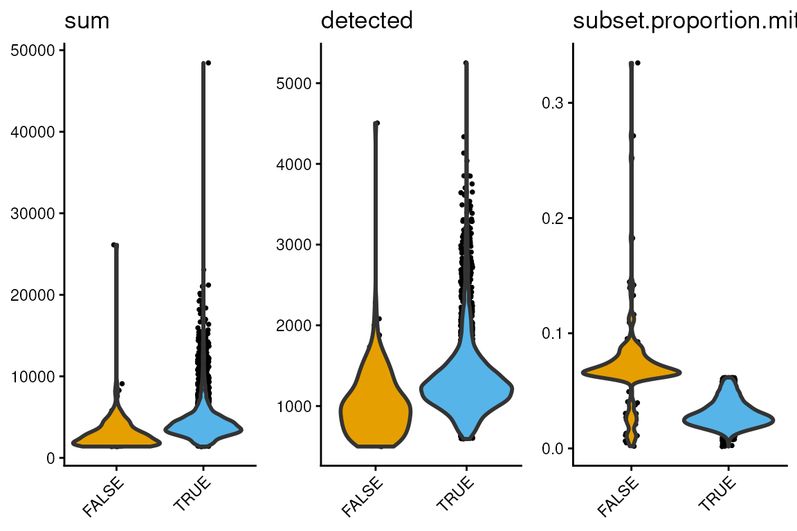
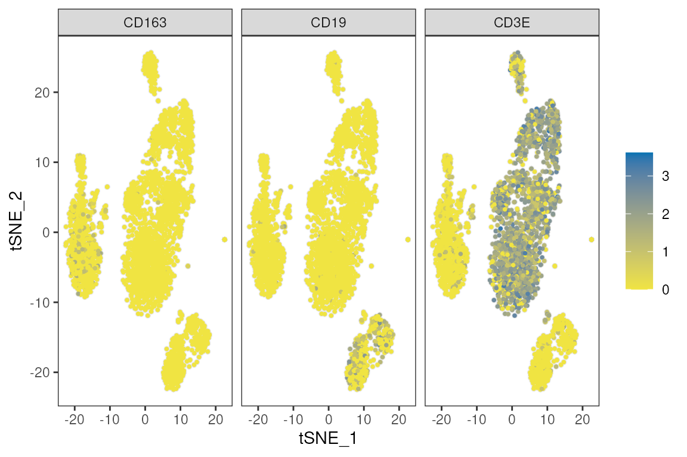
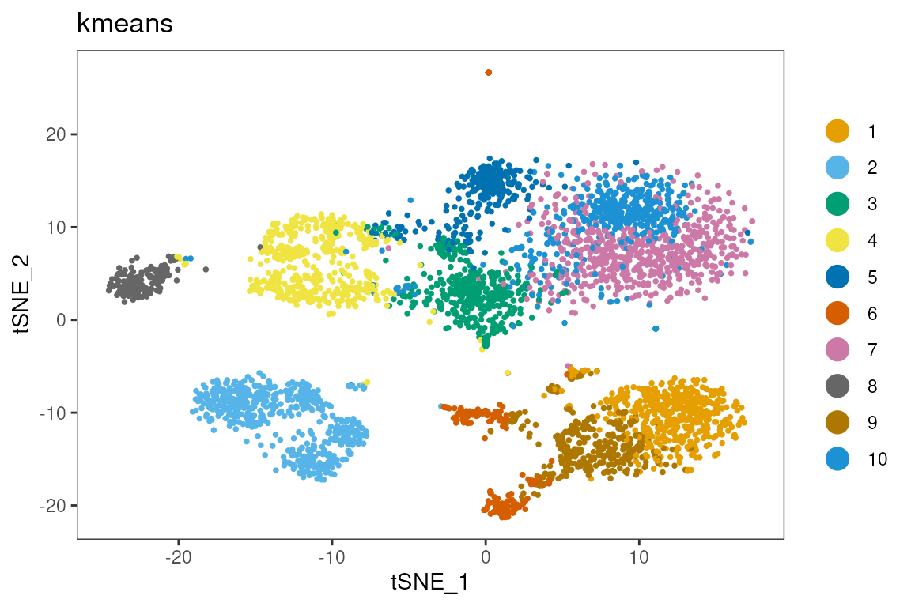
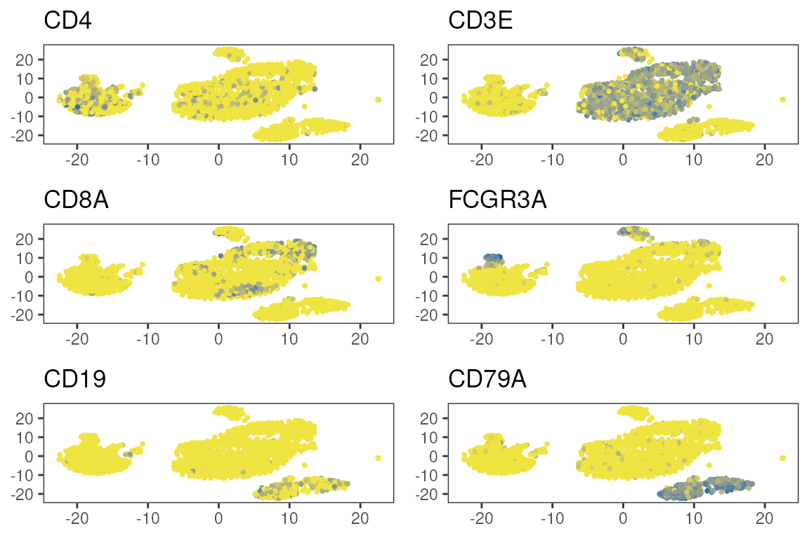

# scRNA-seq single-sample analysis

``` r


library(dittoSeq)
library(scater)
library(TENxPBMCData)
library(scrapper)
library(mclust)
```

## Single-cell RNA-seq in Bioconductor

### Data Loading

We begin by loading in a public dataset from the TENxPBMCData
Bioconductor package. The dataset contains approx. 4,000 cells from
peripheral blood mononuclear cells (PBMCs). These are mostly immune
cells.

Data used are from the *4k PBMCs from a Healthy Donor* dataset released
by 10x Genomics (2017), distributed via the TENxPBMCData Bioconductor
package.

``` r


sce <- TENxPBMCData("pbmc4k")
#> see ?TENxPBMCData and browseVignettes('TENxPBMCData') for documentation
#> loading from cache

citation("TENxPBMCData")
#> To cite package 'TENxPBMCData' in publications use:
#> 
#>   Hansen KD, Risso D, Hicks S (2026). _TENxPBMCData: PBMC data from 10X
#>   Genomics_. doi:10.18129/B9.bioc.TENxPBMCData
#>   <https://doi.org/10.18129/B9.bioc.TENxPBMCData>. R package version
#>   1.30.0, <https://bioconductor.org/packages/TENxPBMCData>.
#> 
#> A BibTeX entry for LaTeX users is
#> 
#>   @Manual{,
#>     title = {TENxPBMCData: PBMC data from 10X Genomics},
#>     author = {Kasper D. Hansen and Davide Risso and Stephanie Hicks},
#>     year = {2026},
#>     note = {R package version 1.30.0},
#>     url = {https://bioconductor.org/packages/TENxPBMCData},
#>     doi = {10.18129/B9.bioc.TENxPBMCData},
#>   }
```

Genes can be labelled in multiple different ways, including Ensembl IDs
and Gene Symbols. We also have some column (cell level) data that the
authors included. We can confirm from the metadata that each cell came
from the same person.

``` r


head(rowData(sce))
#> DataFrame with 6 rows and 3 columns
#>                      ENSEMBL_ID   Symbol_TENx       Symbol
#>                     <character>   <character>  <character>
#> ENSG00000243485 ENSG00000243485  RP11-34P13.3           NA
#> ENSG00000237613 ENSG00000237613       FAM138A      FAM138A
#> ENSG00000186092 ENSG00000186092         OR4F5        OR4F5
#> ENSG00000238009 ENSG00000238009  RP11-34P13.7 LOC100996442
#> ENSG00000239945 ENSG00000239945  RP11-34P13.8           NA
#> ENSG00000239906 ENSG00000239906 RP11-34P13.14           NA

head(colData(sce))
#> DataFrame with 6 rows and 11 columns
#>        Sample            Barcode         Sequence   Library Cell_ranger_version
#>   <character>        <character>      <character> <integer>         <character>
#> 1      pbmc4k AAACCTGAGAAGGCCT-1 AAACCTGAGAAGGCCT         1                v2.1
#> 2      pbmc4k AAACCTGAGACAGACC-1 AAACCTGAGACAGACC         1                v2.1
#> 3      pbmc4k AAACCTGAGATAGTCA-1 AAACCTGAGATAGTCA         1                v2.1
#> 4      pbmc4k AAACCTGAGCGCCTCA-1 AAACCTGAGCGCCTCA         1                v2.1
#> 5      pbmc4k AAACCTGAGGCATGGT-1 AAACCTGAGGCATGGT         1                v2.1
#> 6      pbmc4k AAACCTGCAAGGTTCT-1 AAACCTGCAAGGTTCT         1                v2.1
#>   Tissue_status Barcode_type   Chemistry Sequence_platform    Individual
#>     <character>  <character> <character>       <character>   <character>
#> 1            NA     Chromium Chromium_v2         Hiseq4000 HealthyDonor1
#> 2            NA     Chromium Chromium_v2         Hiseq4000 HealthyDonor1
#> 3            NA     Chromium Chromium_v2         Hiseq4000 HealthyDonor1
#> 4            NA     Chromium Chromium_v2         Hiseq4000 HealthyDonor1
#> 5            NA     Chromium Chromium_v2         Hiseq4000 HealthyDonor1
#> 6            NA     Chromium Chromium_v2         Hiseq4000 HealthyDonor1
#>   Date_published
#>      <character>
#> 1     2017-11-08
#> 2     2017-11-08
#> 3     2017-11-08
#> 4     2017-11-08
#> 5     2017-11-08
#> 6     2017-11-08

table(sce$Individual)
#> 
#> HealthyDonor1 
#>          4340
```

The gene symbols are slightly more user friendly, so we’ll use those.
We’ll also take the opportunity to add colnames to the
SingleCellExperiment object. This is a requirement for the dittoSeq
plotting functions.

``` r


rownames(sce)<-rowData(sce)$Symbol_TENx
colnames(sce)<-sce$Barcode
```

### Quality Control

``` r


is.mito <- grep('^MT-',rownames(sce),value = T)
is.mito
#>  [1] "MT-ND1"  "MT-ND2"  "MT-CO1"  "MT-CO2"  "MT-ATP8" "MT-ATP6" "MT-CO3" 
#>  [8] "MT-ND3"  "MT-ND4L" "MT-ND4"  "MT-ND5"  "MT-ND6"  "MT-CYB"

sce<-quickRnaQc.se(sce,subsets = list(mito=c(is.mito)))
#> using unknown matrix fallback for 'HDF5ArraySeed'
multi_dittoPlot(sce,c('sum','detected','subset.proportion.mito'),group.by='keep')
```



``` r

sce<-sce[,sce$keep] ## autosuggested thresholds
```

Cells might have high or low counts due to technical reasons, retaining
them might skew the analysis.

You can also manually determine thresholds, and subset the object. In
this case, cells with abnormally high counts (\>10,000 per cell) are
removed.

``` r


sce$keepmanual<-sce$sum>10000
multi_dittoPlot(sce,c('sum','detected','subset.proportion.mito'),group.by='keepmanual')
```


``` r


sce<-sce[,!sce$keepmanual]
```

### Dimension Reduction

This dataset contains information about 33,694 genes. Many of these are
uninformative, and others may correlate. Dimension reduction methods
such as PCA compress the features space, reduce noise, and improve
computational efficiency.

Normalisation reduces the effect of sequencing depth. Log transformation
compresses the data and prevents highly expressed genes from dominating
downstream analysis.

PCA is a linear transformation, TSNE (t-distributed stochastic neighbour
embedding) (and UMAP, not shown) is non-linear, and use mostly for
visualising.

``` r


sce<-normalizeRnaCounts.se(sce)
#> using unknown matrix fallback for 'HDF5ArraySeed'

sce <- chooseRnaHvgs.se(sce, top = 1000)
#> using unknown matrix fallback for 'HDF5ArraySeed'
sce<-runPca.se(sce, features=rowData(sce)$hvg,number=100)
#> using unknown matrix fallback for 'HDF5ArraySeed'

sce<-runTsne.se(sce,reddim.type ='PCA')
```

From the PCA and TSNE, we expect similar cell types to group together.
Sometimes, technical effects can outweigh biological effects, such as
[batch
effects](https://bioconductor.posit.co/packages/release/bioc/vignettes/batchelor/inst/doc/correction.html),
but we won’t cover that today. We can confirm this using well-known gene
markers CD3E (T cells), CD163 (myeloid cells) and CD19 (B cells).

``` r


dittoDimPlot(sce,reduction.use = 'TSNE',c('CD3E','CD163','CD19'))
```



``` r

dittoPlot(sce,c('CD3E','CD163','CD19'),group.by='Individual',slot='logcounts')
```



### Clustering

Cells are constantly adapting to their environment. They differentiate
and specialise throughout their lifecycle. While not strictly true, it
can be useful to think of them as falling into discrete states, or
clusters.

Clustering methods group similar cells which ideally represent a cell
type or state. This helps understand the role of different groups of
cells.

As is often the case, there are many ways to perform clustering.

``` r


sce<-clusterGraph.se(sce,reddim.type = 'PCA', num.neighbors = 20,output.name = 'multilevel')
sce<-clusterKmeans.se(sce,reddim.type = 'PCA',k=10,output.name = 'kmeans')

dittoDimPlot(sce,reduction.use = 'TSNE','multilevel')
```


``` r

dittoDimPlot(sce,reduction.use = 'TSNE','kmeans')
```


Here we compare two different clustering results. The adjusted rand
index (ARI) is moderate, and there are still some noticeable
differences.

``` r


table(sce$multilevel,sce$kmeans)
#>    
#>       1   2   3   4   5   6   7   8   9  10
#>   1 687   0   0   0   0   0 157   0   0   0
#>   2   0  72   0   0  35 373   0   0   5   0
#>   3   0 554   0   0  13   0   0   0 439   0
#>   4   0   1 601   1   0   0   0   0   0   0
#>   5   0   9   0 512  18  21   0   3   0   0
#>   6   0   0   0   0   0   0   0   0   0  35
#>   7   0   0   0   2   0   0   0 174   0   0
#>   8   0   0   0   0 203   0   0   0  11   0
#>   9   0   0   0   1   0   0  92   0   0   0

adjustedRandIndex(sce$multilevel,sce$kmeans)
#> [1] 0.7381909
```

``` r

genes<-c('CD4','CD3E','CD8A','FCGR3A','CD19','CD79A')

genes %in% rownames(sce)
#> [1] TRUE TRUE TRUE TRUE TRUE TRUE

multi_dittoDimPlot(sce,reduction.use='TSNE',genes)
```



``` r

head(rownames(sce))
#> [1] "RP11-34P13.3"  "FAM138A"       "OR4F5"         "RP11-34P13.7" 
#> [5] "RP11-34P13.8"  "RP11-34P13.14"
```

### Unsupervised Annotation

This method of annotation looks at genes with high effect sizes in one
cluster vs. the rest. By comparing against the literature, the cell type
and function can be understood.

``` r


markers<-scoreMarkers.se(sce,groups = sce$multilevel,order.by = TRUE)
#> using unknown matrix fallback for 'HDF5ArraySeed'

top_genes <- unique(unlist(lapply(markers, function(df) {
  head(rownames(df)[order(df$cohens.d.mean, decreasing = TRUE)], 5)
}), use.names = FALSE))

top_genes
#>  [1] "LYZ"      "FTL"      "TYROBP"   "CST3"     "S100A9"   "IL32"    
#>  [7] "TRAC"     "LTB"      "CD3D"     "IL7R"     "RPS27"    "RPS6"    
#> [13] "RPL32"    "RPS29"    "RPL34"    "CD79A"    "HLA-DRA"  "CD74"    
#> [19] "CD79B"    "HLA-DPA1" "CCL5"     "NKG7"     "CST7"     "JCHAIN"  
#> [25] "LILRA4"   "IRF8"     "IRF7"     "C12orf75" "GNLY"     "CTSW"    
#> [31] "GZMA"     "PRF1"     "RPL31"    "LST1"     "AIF1"     "SERPINA1"
#> [37] "FCGR3A"

plotGroupedHeatmap(sce,
                   features     = top_genes,
                   group        = 'multilevel',
                   center       = TRUE,
                   scale        = TRUE,
                   zlim         = c(-2, 2),
                   cluster_rows = FALSE,
                   cluster_cols = FALSE)
```


### Rule-based annotation

This method of annotation uses known cell-type gene signatures to label
clusters or cells in a new dataset.

``` r


library(UCell)
counts(sce) <- as(counts(sce), "dgCMatrix")   # in-memory sparse; TENxPBMCData is HDF5-backed

signatures <- list(
  T_cell      = c("CD3D", "CD3E", "CD3G", "CD2", "TRAC"),
  NK          = c("NKG7", "GNLY", "KLRD1", "KLRF1", "CD3D-", "CD3E-"),
  B_cell      = c("MS4A1", "CD79A", "CD79B", "CD19", "BANK1"),
  Plasma      = c("MZB1", "DERL3", "TNFRSF17", "XBP1", "MS4A1-"),
  CD14_Mono   = c("CD14", "LYZ", "S100A8", "S100A9", "VCAN", "FCGR3A-"),
  CD16_Mono   = c("FCGR3A", "MS4A7", "CDKN1C", "LST1", "CD14-", "NKG7-"),
  cDC         = c("FCER1A", "CD1C", "CLEC10A", "CLEC9A", "CD14-"),
  pDC         = c("LILRA4", "CLEC4C", "IL3RA", "PLD4"),
  Platelet    = c("PPBP", "PF4", "GP9", "ITGA2B"),
  Erythrocyte = c("HBB", "HBA1", "HBA2"),
  HSPC        = c("CD34", "SPINK2")
)

sce <- ScoreSignatures_UCell(sce, features = signatures, assay = "counts", name = NULL)
sc  <- assay(altExp(sce, "UCell"))            # signatures x cells
sce$ucell <- rownames(sc)[apply(sc, 2, which.max)]
dittoDimPlot(sce, "ucell", reduction.use = "TSNE")
```


``` r


table(sce$kmeans,sce$ucell)
#>     
#>      B_cell CD14_Mono CD16_Mono cDC HSPC  NK pDC Plasma Platelet T_cell
#>   1       1       675         7   0    0   3   0      0        0      1
#>   2       0         2         0   0    1   1   0      0        0    632
#>   3     594         3         1   0    0   0   0      0        0      3
#>   4       1         4         0   0    0   9   0      0        2    500
#>   5       0         5         0   0    1   0   0      0        0    263
#>   6       0         2         0   1    2   1   0      0        0    388
#>   7       1       122       112   7    0   2   1      1        1      2
#>   8       0         0         0   0    0 168   0      0        0      9
#>   9       0        12         1   0    1   2   0      0        0    439
#>   10      0         0         0   0    0   0  32      3        0      0
table(sce$multilevel,sce$ucell)
#>    
#>     B_cell CD14_Mono CD16_Mono cDC HSPC  NK pDC Plasma Platelet T_cell
#>   1      2       797        29   6    0   5   1      1        1      2
#>   2      0         3         0   1    2   1   0      0        0    478
#>   3      0        13         1   0    1   0   0      0        0    991
#>   4    595         3         1   0    1   0   0      0        0      3
#>   5      0         5         0   0    1   9   0      0        1    547
#>   6      0         0         0   0    0   0  32      3        0      0
#>   7      0         0         0   0    0 169   0      0        0      7
#>   8      0         4         0   0    0   2   0      0        0    208
#>   9      0         0        90   1    0   0   0      0        1      1
```

### Supervised Annotation

- Requires a high quality labelled reference.
- Look for methods like CellTypist, SingleR etc..

### Reflection

- What assumptions did we make?
- What are the limitations of supervised vs. unsupervised annotation?
- How could the analysis have been done differently?
- How does this impact the validity of the results?
- What would have changed if there were cells from multiple samples?

#### How might a data scientist approach this type of problem?

1.  Understand how the data was generated.
2.  Understand the type of analysis (exploratory, hypothesis generation,
    vs. hypothesis testing).
3.  Check the data structure, quality.
4.  Decide on a clear and defensible modelling strategy.
5.  Validate outputs. Big difference between ‘an output’ and ‘a correct
    output’. Use domain expertise, independent datasets, stability and
    reproducibility checks.
6.  Communicate clearly. What claims can you make, and what claims can’t
    you make, based on the data?

#### Some considerations for analysis

- Statistical thinking
  - Data distributions
  - Independence
  - Multiple testing
  - Assumptions
- Computational thinking
  - Scaling
  - Seeds, reproducibility
  - Algorithms
- Communication, visualisation
  - Model assumptions
  - Uncertainty
  - Informative vs. misleading plots
- Tooling
  - Choice of ecosystem
  - Version control
  - Documentation
  - Dependency management (how many packages does each notebook pull in,
    directly and indirectly?).
- Ethics, integrity
  - Reproducibility (again).
  - Choice of reference.
  - Patient privacy and consent.

``` r


sessionInfo()
#> R version 4.6.1 (2026-06-24)
#> Platform: x86_64-pc-linux-gnu
#> Running under: Ubuntu 24.04.4 LTS
#> 
#> Matrix products: default
#> BLAS:   /usr/lib/x86_64-linux-gnu/openblas-pthread/libblas.so.3 
#> LAPACK: /usr/lib/x86_64-linux-gnu/openblas-pthread/libopenblasp-r0.3.26.so;  LAPACK version 3.12.0
#> 
#> locale:
#>  [1] LC_CTYPE=en_US.UTF-8       LC_NUMERIC=C              
#>  [3] LC_TIME=en_US.UTF-8        LC_COLLATE=en_US.UTF-8    
#>  [5] LC_MONETARY=en_US.UTF-8    LC_MESSAGES=en_US.UTF-8   
#>  [7] LC_PAPER=en_US.UTF-8       LC_NAME=C                 
#>  [9] LC_ADDRESS=C               LC_TELEPHONE=C            
#> [11] LC_MEASUREMENT=en_US.UTF-8 LC_IDENTIFICATION=C       
#> 
#> time zone: Etc/UTC
#> tzcode source: system (glibc)
#> 
#> attached base packages:
#> [1] stats4    stats     graphics  grDevices utils     datasets  methods  
#> [8] base     
#> 
#> other attached packages:
#>  [1] UCell_2.16.0                mclust_6.1.3               
#>  [3] scrapper_1.6.3              TENxPBMCData_1.30.0        
#>  [5] HDF5Array_1.40.0            h5mread_1.4.1              
#>  [7] rhdf5_2.56.1                DelayedArray_0.38.2        
#>  [9] SparseArray_1.12.3          S4Arrays_1.12.1            
#> [11] abind_1.4-8                 Matrix_1.7-6               
#> [13] scater_1.40.2               scuttle_1.22.0             
#> [15] SingleCellExperiment_1.34.0 SummarizedExperiment_1.42.0
#> [17] Biobase_2.72.0              GenomicRanges_1.64.0       
#> [19] Seqinfo_1.2.0               IRanges_2.46.0             
#> [21] S4Vectors_0.50.3            BiocGenerics_0.58.1        
#> [23] generics_0.1.4              MatrixGenerics_1.24.0      
#> [25] matrixStats_1.5.0           dittoSeq_1.24.0            
#> [27] ggplot2_4.0.3               BiocStyle_2.40.0           
#> 
#> loaded via a namespace (and not attached):
#>  [1] DBI_1.3.0            gridExtra_2.3.1      httr2_1.3.0         
#>  [4] rlang_1.3.0          magrittr_2.0.5       otel_0.2.0          
#>  [7] ggridges_0.5.7       compiler_4.6.1       RSQLite_3.53.3      
#> [10] png_0.1-9            systemfonts_1.3.2    vctrs_0.7.3         
#> [13] crayon_1.5.3         pkgconfig_2.0.3      fastmap_1.2.0       
#> [16] dbplyr_2.6.0         XVector_0.52.0       labeling_0.4.3      
#> [19] rmarkdown_2.32       ggbeeswarm_0.7.3     ragg_1.5.2          
#> [22] purrr_1.2.2          bit_4.6.0            xfun_0.61           
#> [25] cachem_1.1.0         beachmat_2.28.0      jsonlite_2.0.0      
#> [28] blob_1.3.0           rhdf5filters_1.24.1  Rhdf5lib_2.0.0      
#> [31] BiocParallel_1.46.0  irlba_2.4.1          parallel_4.6.1      
#> [34] R6_2.6.1             bslib_0.12.0         RColorBrewer_1.1-3  
#> [37] jquerylib_0.1.4      Rcpp_1.1.2           bookdown_0.48       
#> [40] knitr_1.52           tidyselect_1.2.1     yaml_2.3.12         
#> [43] viridis_0.6.5        codetools_0.2-20     curl_8.0.0          
#> [46] lattice_0.22-9       tibble_3.3.1         KEGGREST_1.52.2     
#> [49] withr_3.0.3          S7_0.2.2             evaluate_1.0.5      
#> [52] desc_1.4.3           BiocFileCache_3.2.0  Biostrings_2.80.2   
#> [55] ExperimentHub_3.2.2  filelock_1.0.3       pillar_1.11.1       
#> [58] BiocManager_1.30.27  BiocVersion_3.23.1   scales_1.4.0        
#> [61] glue_1.8.1           pheatmap_1.0.13      tools_4.6.1         
#> [64] AnnotationHub_4.2.2  data.table_1.18.6.1  BiocNeighbors_2.6.0 
#> [67] ScaledMatrix_1.20.0  fs_2.1.0             cowplot_1.2.0       
#> [70] grid_4.6.1           AnnotationDbi_1.74.0 colorspace_2.1-4    
#> [73] beeswarm_0.4.0       BiocSingular_1.28.1  vipor_0.4.7         
#> [76] cli_3.6.6            rsvd_1.0.5           rappdirs_0.3.4      
#> [79] textshaping_1.0.5    viridisLite_0.4.3    dplyr_1.2.1         
#> [82] gtable_0.3.6         sass_0.4.10          digest_0.6.39       
#> [85] ggrepel_0.9.8        htmlwidgets_1.6.4    farver_2.1.2        
#> [88] memoise_2.0.1        htmltools_0.5.9      pkgdown_2.2.1       
#> [91] lifecycle_1.0.5      httr_1.4.9           bit64_4.8.6
```
